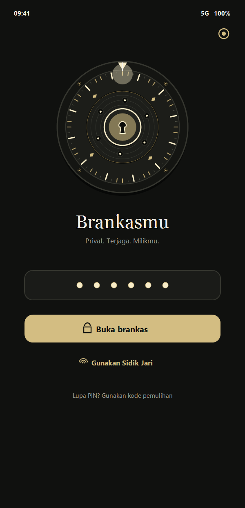
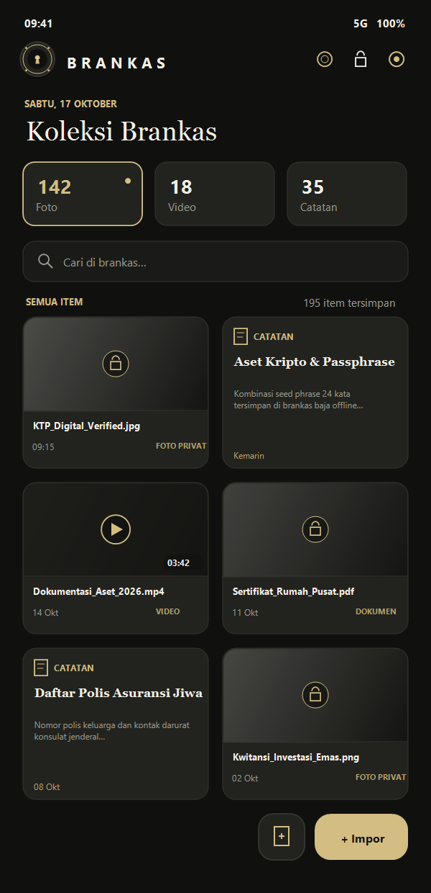

<p align="center">
  <br />
  <h1 align="center">B R A N K A S</h1>
  <p align="center">
    <strong>A sovereign, local-first Android vault engineered with certified AES-256-GCM encryption and a restrained luxury interface.</strong>
  </p>
  <p align="center">
    <a href="LICENSE"></a>
    
    
    
    
    <a href="https://github.com/ganezha/brankas-android/actions/workflows/android.yml"></a>
  </p>
</p>

---

## Visual Showcase Gallery

<p align="center">
  
  &nbsp; &nbsp;
  
</p>
<p align="center">
  <em>Figure 1: The Precision Unlock Chamber &nbsp; &nbsp; | &nbsp; &nbsp; Figure 2: Populated Encrypted Vault Repository</em>
</p>

---

### Systemic Technical Deep-Dive

#### 1. The Precision Unlock Chamber (Figure 1)
* **Procedural Vector Kinematics:** The 60-division radial combination dial is computed and rendered in real-time on a pure Jetpack Compose 2D Canvas—eliminating third-party 3D engine overhead and delivering locked 120Hz frame-pacing without dropped frames.
* **Multi-Layered Optical Parallax:** The mechanical dial features depth-tiered vector layers responding to touch coordinates through calibrated physical spring dynamics (damping ratio 0.65, medium-low stiffness), accompanied by an alternating rotation sequence on consecutive PIN strokes.
* **Volatile Memory Sanitization:** Secret credentials are never stored in immutable heap `String` objects. Instead, PIN entries are managed in mutable `CharArray` buffers that are explicitly zeroed out (`.fill('\u0000')`) immediately after key unwrapping via PBKDF2 (310,000 iterations).

#### 2. Populated Vault Repository (Figure 2)
* **Zero-Decryption Indexing Architecture:** Brankas maintains rapid indexing across hundreds of confidential photos, 4K videos, and encrypted notes. The master index (`index.enc`) contains solely authenticated metadata headers (UUID, MIME type, digest hash, and creation timestamps). Media payloads are never batch-decrypted into RAM; they are streamed through isolated, on-demand decryption pipelines only when selected.
* **Atomic Storage Access Framework (SAF) Staging:** File ingestions execute a two-phase commit protocol. The app validates dual SHA-256 digests and AEAD verification tags in temporary sandbox staging before requesting Android's document provider to delete the original source. If deletion is rejected by the provider, the encrypted item remains secure in Brankas while the source file remains untouched (*fail-safe staging*).
* **Hardware-Enforced Surface Isolation:** The application enforces `FLAG_SECURE` at the OS window manager level, blocking hardware screen capture, screencasting, and automatic visual snapshot caching in the Android Recent Tasks switcher.

---

## Cryptographic Specification Matrix

Designed for independent security verification and cryptographic audits:

| Security Vector | Implementation Parameter | Cryptographic Standard / Reference |
| :--- | :--- | :--- |
| **Symmetric Cipher** | AES-256-GCM (`NoPadding`) | NIST SP 800-38D (12-byte random IV, 128-bit authentication tag) |
| **Key Derivation (KDF)** | PBKDF2WithHmacSHA256 | **310,000 iterations** (OWASP 2023+ Password Storage Recommendations) |
| **Hardware KeyStore** | Biometric-gated AndroidKeyStore | `setUserAuthenticationRequired(true)` via biometric `CryptoObject` |
| **Integrity Verification** | Trailing SHA-256 Digest | End-to-end streaming digest check against ciphertext tampering |
| **Volatile Sanitization** | Explicit Buffer Zeroing | Sensitive arrays cleared via `.fill(0)` / `.fill('\u0000')` post-computation |
| **Storage Sandbox** | App-isolated scoped storage | Stored in `context.filesDir` with Android automatic cloud backup disabled |
| **Backup Archive Format** | `BRANKASBK1` container | Self-contained, authenticated payload with zero plaintext leakage |

---

## Zero-Network Guarantee

> **Privacy Manifesto:** Brankas operates on an uncompromising zero-trust, offline-only architecture.

* **No Network Permission:** The `android.permission.INTERNET` permission is completely omitted from `AndroidManifest.xml`. It is impossible for the binary to communicate across local networks or the internet.
* **Zero Telemetry & Analytics:** No analytics daemons, crash reporters, or external tracking SDKs are compiled into the codebase.
* **Air-Gapped Standalone Backups:** Encrypted backups (`BRANKASBK1`) can be exported to offline physical media (USB drive, SD card) and restored on another device using the original PIN or recovery key.

---

## Architectural Highlights

* **Pure Jetpack Compose 2.0:** Modern, declarative UI implementing the restrained *Charcoal and Warm-Gold* aesthetic (`Ink: #10110F`, `Panel: #1A1B18`, `Line: #35362F`, `Gold: #D3BD82`).
* **Independent Authenticated Note Bodies:** Note bodies are stored in individual encrypted files rather than crammed into the index, ensuring opening the vault never exposes note contents to heap analysis.
* **Air-Gapped Recovery Mechanism:** A one-time high-entropy recovery code is generated upon initialization, providing a mathematical fail-safe to unwrap the master key if the PIN is forgotten.
* **Crash-Safe Vault Migration:** Legacy vaults are migrated transactionally on first launch with atomicity guarantees.

---

## Developer & Verification Workflow

### Prerequisites
* **JDK:** Version 17
* **Android SDK:** Platform 35 / Build-Tools 35.0.0
* **Gradle:** 8.11.1 (via included wrapper)

### 1. Run Cryptographic & Unit Test Suite
Verify that all unit tests (including PBKDF2 iteration bounds, AES-GCM roundtrips, migration atomicity, and recovery routines) pass:

```powershell
.\gradlew.bat testDebugUnitTest
```

### 2. Build Debug APK
To assemble the debug build for local testing and inspection:

```powershell
.\gradlew.bat assembleDebug
```
*Output artifact:* `app/build/outputs/apk/debug/app-debug.apk`

### 3. Build Optimized Release APK
To assemble the release variant with R8 code shrinking, resource shrinking, and symbol obfuscation:

```powershell
.\gradlew.bat assembleRelease
```
*Output artifact:* `app/build/outputs/apk/release/app-release-unsigned.apk`

> [!NOTE]
> For production distribution, sign the APK using Android Studio's **Generate Signed Bundle / APK** flow. Never commit signing keys or passwords to the repository (`.gitignore` enforces isolation for keystores and signing properties).

---

## Security Policy

Security vulnerabilities are treated with the highest priority. If you identify a flaw in the cryptographic model, memory lifecycle, or file staging pipeline, please refer to our responsible disclosure policy in [SECURITY.md](SECURITY.md).

---

## License

This project is open-source software licensed under the **GNU General Public License v3.0**. See the [LICENSE](LICENSE) file for complete terms and conditions.
